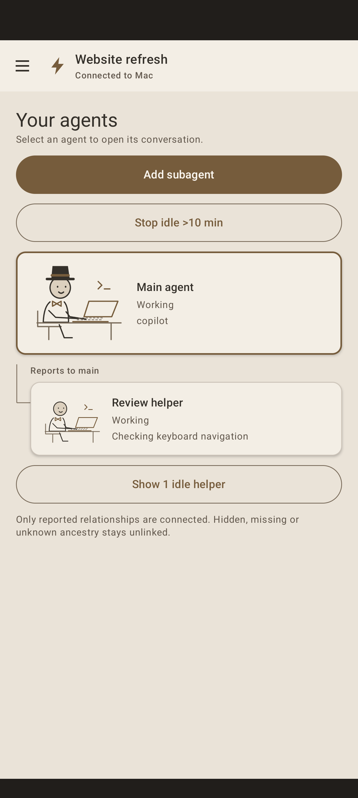
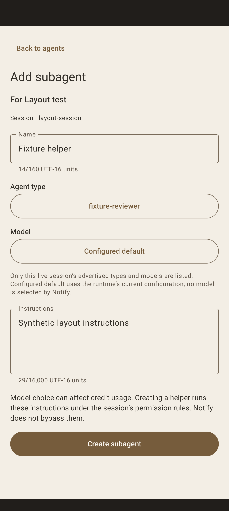

# Notify for Android

**Your terminal agents, within reach.**

Step away from your Mac without losing the conversation. Notify brings agent
approvals, chats and your team of helpers to your phone, so you can answer a
question or send a direction without switching back to the terminal.

[**Download the APK**](https://github.com/vsvinav/notify-android/releases) ·
[Get started](docs/guide.md#install) ·
[Connect your Mac](docs/guide.md#connect-your-mac) ·
[User guide](docs/guide.md)

## What you can do

| | |
|---|---|
| **Answer from your phone** | Review waiting approvals, allow or deny an action, choose an offered answer, or write your own when supported. |
| **Keep the conversation moving** | Send a direction to Copilot before its next model request, queue it for later, or confirm an interrupt or stop. |
| **Work with your agent team** | Open a main agent or helper's chat, see reported tasks and models, add supported subagents, and manage idle or ended helpers. |
| **Catch up offline** | Read the latest eight saved messages per conversation after disconnecting. Your connected view keeps the history supplied by the Mac. |
| **Read and copy comfortably** | Native Markdown, distinct code blocks, exact code copying, and light or dark appearance. |
| **Know when you're needed** | Optional phone notifications and vibration alert you to waiting work without putting conversation content in the notification. |
| **Keep sessions organized** | Search and filter, choose session colors, reorder within groups, and resume supported saved sessions on your Mac. |

## A look inside

**Your team at a glance.** See the main agent and its helpers, with idle and
inactive groups tucked away until you need them.

<picture>
  <source media="(prefers-color-scheme: dark)" srcset="docs/images/android-agents-native-dark.png">
  
</picture>

**Add a helper. Stay in control.** Give a supported subagent instructions and
choose from the models your Mac reports. Session controls stay close to the chat.

  
  

**Keep reading, even after disconnecting.** Saved conversations are clearly
read-only. Markdown and code copying make replies easier to use.

  
  

*These are native Android captures using fictional data in an isolated test app,
not live conversations. The saved date is synthetic.*

## Made to work with your Mac

Notify is a companion to [Notify for macOS](https://github.com/vsvinav/notify),
not a separate AI subscription. Your agents keep running in their original
terminals; instructions use your existing model access and may consume credits.
The phone needs **Android 9+ on arm64**. Live controls and alerts need your Mac
awake, online, running Notify and with Internet access enabled.

Copilot offers the supported chat and helper controls. Claude approvals and
questions depend on its hooks; live Claude Send/Interrupt/Stop and helper creation
are not supported. Older connections show what is available rather than pretending
to support newer controls.

**You decide what runs.** Pairing requires your explicit approval on the Mac.
Offline history cannot approve or send anything, and uncertain instructions are
never automatically retried. Optional **Dangerous Auto-yes** requires a separate
high-risk confirmation: it can approve destructive eligible tools and stays on
when the phone disconnects. [Understand the controls](docs/guide.md#session-settings).

## Ready to try it?

Download the latest **[0.3.3 beta APK](https://github.com/vsvinav/notify-android/releases/tag/v0.3.3-beta.1)**,
then follow the [installation and pairing guide](docs/guide.md#install).
This is a preview; [release notes](https://github.com/vsvinav/notify-android/releases)
describe what was checked and the remaining device-testing limits.

[Notifications & vibration](docs/guide.md#background-notifications) ·
[Connection help](docs/guide.md#connect-your-mac) ·
[Privacy](docs/guide.md#notification-routing-and-privacy) ·
[Release instructions](docs/guide.md#releases-and-updates)
