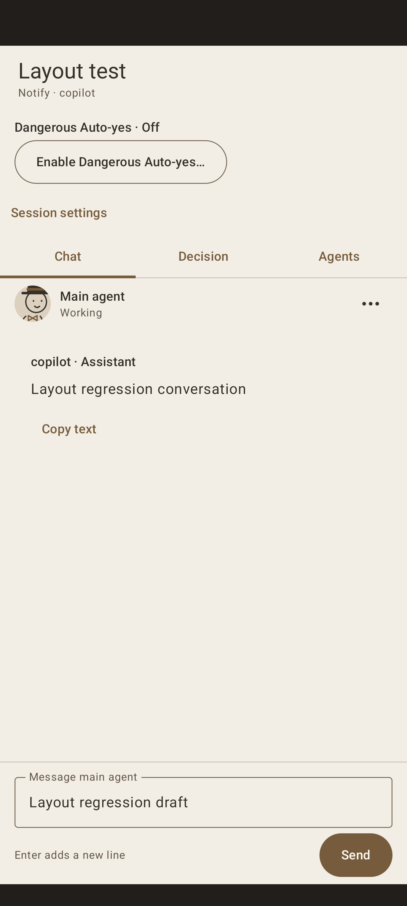
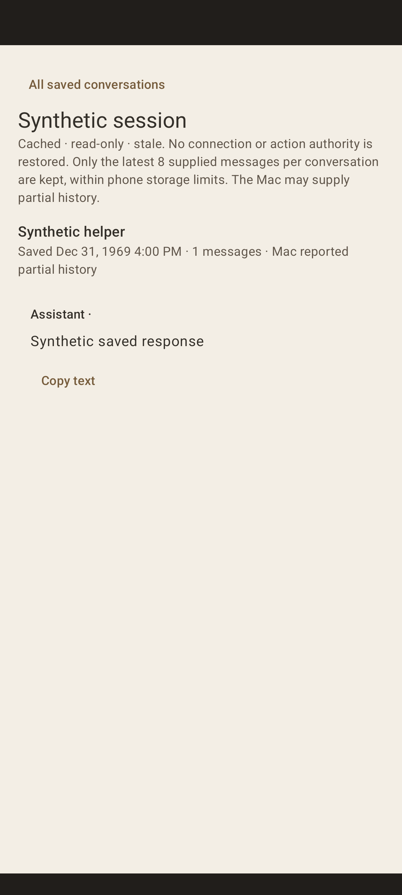
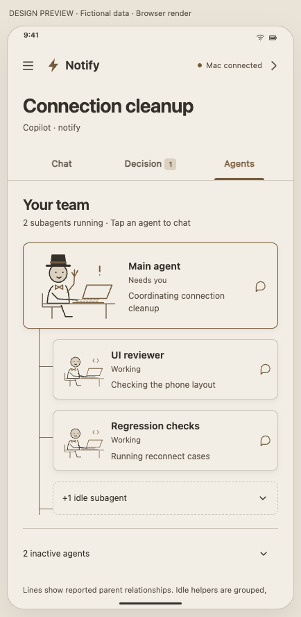
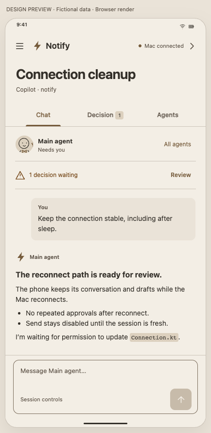
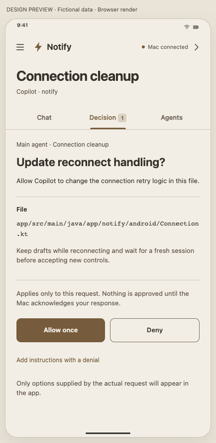
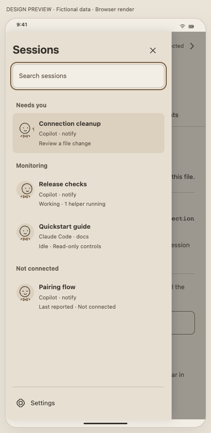

# Notify for Android

A native Android remote controller for Notify on your Mac.

**Keep your agents within reach.** Review decisions, follow conversations, and
select the main agent or a helper without returning to your terminal.

[Install](#install) · [Connect](#connect-your-mac) · [Native screenshots](#native-screenshots) · [Supported controls](#sessions-and-supported-controls)

## Install

Requires **Android 9 or later on an arm64 device**, an awake Mac running Notify,
and access to the compatible Notify internet service.

1. Download the APK and checksum from this private repository's
   [releases](https://github.com/vsvinav/notify-android/releases).
2. Verify the download against its published SHA-256 checksum. Install only an
   APK from a source you trust; a checksum is not an Android trust certification.
3. Open the APK and follow Android's installation prompt. If required, allow
   installation for that specific browser/file app, then disable that permission
   again afterward.
4. Open **Notify**, then follow the QR pairing steps below.

For updates, install the new APK over Notify without uninstalling or clearing its
data. Updates must use the same signing identity to retain the saved pairing.

**Current prerelease:** **[0.3.3 beta](https://github.com/vsvinav/notify-android/releases/tag/v0.3.3-beta.1)**.
The release includes the installable APK and its SHA-256 checksum, QR scanning,
reconnect improvements, Mac-style agents, the matching amber lightning icon and
the controls below. This is an agent-tested preview, not full physical-device
acceptance; read its known limitations before installing. New session controls
require matching updated Mac/helper builds.

0.3.1 fixes missing foreground alerts and preserves editable drafts during
reconnection or uncertain delivery. With Mac beta 5/build 11, background alerts
no longer depend on an open phone conversation. An installed-build, real-internet
locked-phone check confirmed notification delivery and physical vibration.
This is bounded acceptance, not a guarantee of delivery on every device/network.

### 0.3.3 (code 6): offline reading and immediate Send

This update adds encrypted, phone-local conversation reading after a
disconnect or app restart. **Read saved conversations · offline** is available
from the sign-in screen without a new service login; it does not sign you in or
restore a Mac connection. The original passkey sign-in path remains available.

Connected conversations retain all history supplied by the Mac (which can itself
be partial). Only the latest **8 messages per main/helper conversation** are
saved, with a maximum of **32 conversations / 4 MiB** of encoded display data;
least recently refreshed conversations are evicted to fit. Cached views show
their save time and are labeled stale, bounded and read-only. Reconnection uses
fresh Mac content instead of merging or replaying cached messages.
Saved instruction attempts retain their reported delivery label, including
unknown or failed, rather than implying the Mac acknowledged them.

The cache contains display text, names, timestamps and target IDs, scoped to the
saved account, pinned Mac and phone pairing. It contains no request/approval
objects, tickets, capabilities, credentials or command ledgers. It uses
AndroidKeyStore AES-GCM and atomic app-private no-backup files, with no plaintext
fallback. Storage or key failures are reported in the app. **Sign out**, **Forget
this phone’s pairing**, and explicit cache clearing erase saved history;
disconnecting and restarting do not. Clearing while connected permits subsequent
fresh Mac updates to be saved again. Anyone able to open the unlocked app can read
its saved conversations; service sign-in is not a local app lock.
Sign-out attempts local notification opt-out, cache erasure, routing removal and
service logout independently; failures are reported with recovery instructions.
Failed routing removal remains pending rather than being presented as completed.

Model responses gain native headings, lists, bold/italic/inline code and distinct
fenced code blocks with **Copy code**. Code copy preserves the fence's contents,
including whitespace and line endings; **Copy text** still copies the original
complete message source. Other syntax stays readable as text. Oversized or highly
fragmented Markdown falls back to literal source. No WebView, executable HTML,
remote images, link fetches or new Markdown dependency is used.

Main-agent **Send** now steers before the next model
request, without interrupting the current turn, when both the session extension
and Mac/helper advertise immediate steering support. **Queue draft** remains in
Session actions; **Interrupt** and **Stop** remain separate confirmed controls.
Older connections show **Queue** with update/reload guidance instead of promising
immediate Send. Update Mac Notify and reload its extension in each existing
Copilot terminal to enable this feature. Helper **Send** still addresses only
the selected supported helper.
**Submitted** means accepted but not yet consumed; only a matching runtime user
message makes the receipt **received**, which may already be reported in the
control response if consumption precedes the SDK acknowledgment.
Saved attempts retain these status labels,
and uncertain deliveries are never retried automatically.

The steering changes passed 181 JVM tests and both lints. Three isolated native
phone checks passed for supported Send placement, legacy Queue guidance and
editable composer state during busy/uncertain delivery. The exact signed APK was
installed in place with pairing retained. These checks do not send real agent
instructions or establish physical keyboard typing/deletion. Before this update, the
history/Markdown milestone passed 174 JVM tests and four isolated
physical-phone tests covering encrypted storage/tampering/clear, exact code copy
and the read-only reader, including narrow enlarged-text layout. The signed
candidate was installed in place. Physical keyboard typing, the full production
disconnect/restart flow and TalkBack remain unverified; these checks are not a
claim of complete device acceptance.

## Native screenshots

Captured on an Android phone from the shipping Compose components and theme,
using **fictional sessions in an isolated test app**. The connected label is
fixture data, not evidence of a live connection. No real agents were operated.

<picture>
  <source media="(prefers-color-scheme: dark)" srcset="docs/images/android-agents-native-dark.png">
  
</picture>

Eleven native layout checks passed, including narrow 320dp / 130% text cases,
light/dark appearance, creation, session settings and visible policy actions.
TalkBack, keyboard interaction, camera and live control execution are separate
acceptance checks; these captures do not establish them.

The reader adds native Markdown/code copying and a read-only offline
conversation view. These phone captures use isolated fictional text and a
synthetic saved timestamp, not a production conversation or connection.

Earlier browser design previews

**These are browser-rendered design previews, not native Android screenshots.**
They show the approved direction using fictional sessions.

<picture>
  <source media="(prefers-color-scheme: dark)" srcset="docs/images/android-agents-preview-dark.png">
  
</picture>
<picture>
  <source media="(prefers-color-scheme: dark)" srcset="docs/images/android-chat-preview-dark.png">
  
</picture>

  
  

Every preview is labeled in the image itself. The native implementation uses
static state-specific agent poses; these images do not establish live connection,
camera, notification or control behavior.

## Connect your Mac

1. On your Mac, open Notify's **Internet access** settings and enable internet.
   The updated Mac helper prepares a fresh QR automatically. On older builds,
   after a preparation error or when the invitation expires, choose
   **Pair an internet device**. This does not reset saved pairing.
2. In Android, tap **Scan Mac QR**. Camera permission is requested only then.
   Scan the Mac's QR, or use **Paste pairing link instead**.
3. Continue with your existing Notify account passkey. Already signed in?
   Notify uses that account without asking you to type it again. A new account
   requires a name and a passkey; an expired authentication may require passkey
   verification again.
4. Compare the **complete phone public key** on both screens and explicitly
   approve it on the Mac. Scanning is not approval.
5. Once connected, choose **Enable alerts** in the optional notification setup
   step, or **Not now** to continue without notifications. Enable alerts requests
   Android notification permission where required, then registers this phone
   through your signed-in account. Alerts are not shown as On until permission,
   channel availability and registration are confirmed.

**After restarting Notify on the Mac:** turn **Enable internet** on again.
Internet access starts off on every Mac app launch; same-Wi-Fi access being on
does not enable the Android internet connection. If the phone remains Connecting
or Waiting for Mac, check this switch before trying Reconnect. Do not reset or
re-pair solely because the Mac's internet access was off.

The QR supplies the invitation and pinned Mac key. This build supports only
`https://notify-remote.onrender.com`; a QR for another service is rejected and
cannot transfer your account or trust. Phone renaming is optional.

Scanning is on-device using CameraX and ZXing. Notify does not save or upload
camera images, open scanned URLs, or collect scan analytics. Leaving the scanner,
backgrounding the app, cancelling, or accepting a valid QR stops its camera.
If permission is denied or no back camera is available, paste the complete link.
Invalid QR content stays in the scanner with a recovery message.

For an expired invitation, request a fresh QR on the Mac. If enrollment already
started but was not confirmed, **Recover with a fresh QR** asks before deleting
the unconfirmed phone identity. First reject/revoke that phone on the Mac: deleting
the local key does not revoke it remotely. An existing saved pairing is never
replaced silently.

An enrolled pairing is saved on this phone. Signing in to its matching account
reconnects it; switching back to Notify reconnects an active session. Account
sign-in itself is not persisted across app restarts. A different account does
not acquire the saved Mac's access. Disconnection does not resend replies,
instructions or uncertain operations. The Mac must remain awake and online.
If an existing channel's routing renewal returns HTTP401, Notify retires that channel
and attempts a fresh authenticated connection using the saved pairing. Rejected
account/device authorization on that fresh attempt still stops recovery; it never
reuses the old renewal or resends pending instructions.

## Sessions and supported controls

Notify opens to chat, or **Choose a session** when nothing is selected. Use the
menu button / **Open sessions** for the session drawer; on wider screens the
drawer stays visible. **Settings** is pinned at its bottom. With the keyboard open,
the drawer stays above it; when space is too short, its search, Settings, and
results scroll together instead of leaving the results with no room. Search and
filter reported sessions by name/project, provider or **Needs you**. Session rows
show character portraits and reported running/idle helper counts when available,
grouped into **Needs you**, **Monitoring**, **Not connected**, and (with updated
Mac metadata) **Saved**. Search and filters retain the Mac's order.

Each selected session has **Chat**, **Decision**, and **Agents** tabs. **Agents**
uses the Mac's illustrated characters and warm light/dark palette: the main agent
wears a top hat, working helpers stay visible, and idle and inactive helpers
collapse separately into counts. Expand a group to see its agents, tasks and models.
Only reported parent relationships are connected; hidden, missing, unknown or
cyclic ancestry stays explicitly unlinked. Stopped cards have X-eyes and cannot
be opened; completed/failed helpers retain read-only history. A partial snapshot
is not the full Mac history. On sufficiently wide content areas, the team appears
beside Chat or Decision. Portraits and poses are static, with stale teams labeled
**Last reported**, not animated as live. The launcher uses the Mac lightning
silhouette in amber on warm charcoal; Android system typography is retained.

Select the main agent or a helper to see its own chat. Supported Copilot sessions
allow sending instructions, interrupting the main agent, and stopping an exact
target. The **Session actions** menu contains **Tools & thinking**, **Stop**, and
main-agent **Interrupt main with draft**. Stop/interrupt require confirmation.
The composer stays separate from the scrolling conversation and respects the
keyboard; its editor and explanations normally scroll independently, with Send
kept below them. At very short heights or large font sizes, the surroundings scroll
instead and history is available through **Show conversation**, so the editor
cannot be squeezed to zero height. Drafts and
conversation positions remain tied to their exact targets during this app session.
Connection refreshes no longer discard drafts. The editor remains usable while
disconnected, sending, or awaiting an uncertain result; Send still requires a
fresh supported target and a safe delivery state. An acknowledgment clears only
the exact draft revision sent, never text you edited afterward. Drafts are not
stored across app restarts. Published 0.3.1 does not store offline history; the
unreleased 0.3.2 candidate adds the bounded reader described above.
Changing filters never selects a different session.

### Session settings (0.3.0 beta)

Open **Session settings** for the selected session. These controls require matching
updated Mac **and** helper builds; older builds explicitly remain unavailable.
They are not in the published 0.2.0 APK.

- **Session color / Reset automatic:** use the Mac's twenty named colors, or
  restore its original eight-color automatic assignment. Existing custom RGB
  colors remain visible, even when not in that palette. Overrides and order use
  the original session identity across reconnects. A failed save is not success.
- **Move up / Move down:** move only within the Mac's current status group.
  Targets include rows hidden by phone search/provider filters. The Mac rechecks
  both exact rows and persists the shared order; replies and snapshots do not
  reorder it.
- **Remove from Notify…:** confirmation removes only an actually disconnected
  cached row. It never stops a live owner, deletes CLI history/project files, or
  unpairs the phone. Discovery can bring the history back. A reconnected row is
  rejected, and disappearance is never fabricated before a native update.
- **Resume on Mac…:** confirmation names the saved session and launches its
  original Copilot or Claude CLI in iTerm2, using only Mac-owned identity, history
  and project information. The original executable, history and iTerm2 must be
  available. A live owner or an in-progress launch prevents duplicates. Sign-in
  or macOS Automation prompts may need attention on the Mac. Saved CLI modes and
  permissions, including prior allow-all, can carry over; this action sends no
  approvals or connection consent and does not enable Notify's session Auto-yes.
  **Launched is not connected:** the Mac separately reports checking/launching,
  awaiting connection, detected owner, or an actual matching Notify connection.
  After 30 seconds without an owner, it warns that launch remains unconfirmed.
  Failed/uncertain launches are not retried automatically or replayed on reconnect;
  check the Mac before any further launch. If the Mac observes that launch's
  original owner and later sees it exit back to Saved, it can authorize a new
  explicit resume review—even when the owner never connected to Notify or this
  phone missed intermediate updates and another phone subsequently resumed it.
  A replaced Mac app/session/project does not count as proof that an old
  uncertain launch finished.

A stale session-setting review rejected before dispatch is a visible failure,
not an uncertain write. Refresh and review a new action; its old command is not
replayed. Color/order changes alone never clear an uncertain resume.

**Settings → Appearance · this phone** offers **System** (default), **Light**, and
**Dark**. It saves locally and applies the existing Notify theme immediately.
It changes neither macOS nor Android's global appearance. Notification controls
are unchanged. New controls have headless/unit coverage and eleven on-device
fictional layout checks using the shipping theme. TalkBack, keyboard interaction
and real CLI-resume acceptance still require separate device/Mac testing.

**Dangerous Auto-yes (0.3.0 beta):** with matching updated Mac
and helper builds, the session header controls the existing Mac-owned policy.
Enabling requires a high-risk confirmation: waiting and future eligible tools
may be approved immediately, including destructive work. Questions remain manual;
normal session Auto-yes and Dangerous Auto-yes are mutually exclusive.
The red On indicator and direct **Turn off now** remain available across the
session tabs, without changing chat targets or drafts. State changes require a
Mac acknowledgment. Offline or uncertain state retains last-known On/unknown;
it never claims Off or automatically retries a toggle. Older builds show unsupported.
Off keeps reserved command capacity even when ordinary history is full. If the
helper confirms an attempt was not dispatched, refresh and explicitly tap Off again.
An unknown Off cannot be sent again for the same policy epoch; check the Mac.

**Disconnecting the phone does not turn it off.** It remains enabled for that
session until manually disabled or the session stops. Provider disconnect,
capability loss, errors, dispatch failures and Mac shutdown retain native
fail-safe resets. These controls are not in the published 0.2.0 APK. Native
visibility checks passed; no real session policy was changed during those checks.

**Helper management (0.3.0 beta):** open the selected session’s
**Agents** tab and choose **Add subagent**. The native form offers only live Mac
agent-type and model IDs. **Configured default** leaves model selection to the
runtime, including when no explicit models are advertised. Review credit usage
and permission rules before **Create subagent**. Unavailable/old/offline runtimes
explain why the visible action is disabled; Claude creation is not supported.
Form values stay separate from chat drafts and survive navigation/reconnection
within the app session. Only a matching **created** acknowledgment clears an
unchanged form; edits made while waiting are retained. Catalog changes invalidate
reviewed actions without silently changing their model or clearing chat drafts.

Expand inactive helpers for the separate, confirmed **Remove from list** action.
Only known completed, failed or cancelled helpers are eligible. A retained helper
already absent from the runtime reports failure, not a fabricated removal.
**Stop idle >10 min** confirms cleanup of the **selected session only**; eligible
helpers and descendants may stop, never main agents or other sessions. The Mac
rechecks continuously observed idle time and ancestry. Neither action deletes
files or schedules background cleanup. Actual runtime status and counts, including
skipped, failed and uncertain outcomes, appear in Agents. Queue acceptance is not
creation/removal success; timeouts stay unknown and are never retried automatically.
These controls require matching updated native Mac, helper and Android builds.
They have headless synthetic coverage and native fictional form/layout checks,
not acceptance of real agent creation, removal or cleanup.

Claude and other unsupported provider controls remain read-only. **Decision** opens
the selected session's real approvals and questions; the drawer's **Needs you**
entry keeps all sessions' pending requests discoverable. Review the
scrolling details before the action buttons; offered permission scopes, denial
feedback and question validation remain intact, followed by exact-reply confirmation.
Denial feedback is retained for the unchanged request while navigating or reconnecting;
changed/removed requests and signing out clear it.

Stale/offline state disables actions. Uncertain delivery must be checked on the
Mac; it is not replayed. A connection indicator alone is not proof that the latest
workspace or request snapshot is available.
Tap the title/connection status to open real connection controls. The toolbar
distinguishes channel state from stale request or workspace updates. Reconnecting
does not replace an already-open conversation or draft with setup forms.
An initial pending approval still shows the complete keys for comparison on the Mac.

**Settings** groups Connection, Notifications, and Account & pairing. Reconnect
and details are under Connection; full public keys and confirmed Forget are under
**Pairing & security**. Sign out keeps the pairing and still requires notification
routing cleanup. Back returns from details, diagnostics, and third-party notices.

### Remaining parity work

This is not full Mac feature parity. Richer conversation presentation remains
planned. Session colors/order, disconnected-cache removal, supported resume and
phone-local appearance are 0.3.0 beta controls described above, not
features added to older downloaded APKs.

Terminal/folder integration, extension installation and macOS floating windows
remain Mac-only. Native Android camera/permission behavior, visual layout and
stable physical-phone connectivity require device acceptance; synthetic QR/JVM
tests do not establish those outcomes.

## Background notifications

Opt in during the first connected setup step, or under **Settings → Notifications**
after signing in and enrolling this phone. The setup step is remembered once shown,
so declining or leaving it does not cause repeated prompts on every launch.
Declining alerts does not disconnect the Mac. If permission or the channel is
disabled, use the offered Android notification/vibration settings link, then retry.
Android 13+ also requires notification permission. The **Mac attention** channel
controls sound, vibration and interruption; Notify never overrides channel choices
or Do Not Disturb. The original generated cue is reproducible with
`python3 crypto/generate-attention-sound.py`.
Camera permission is requested only when choosing Scan. Vibration uses the existing
normal VIBRATE permission and channel settings, not a separate runtime dialog.

In the 0.3.0 beta build, new installations default to two longer pulses:
300 ms, a 180 ms pause, then 450 ms. Existing installations keep their original
channel until you choose **Settings → Notifications → Use longer vibration**.
Switching preserves muted/disabled alerts and does not change consent or register
the phone again. An already customized destination channel is left unchanged;
if switching would make alerts louder or re-enable them, Notify keeps the old
selection and asks you to resolve the difference in Android settings. Longer
pulses do not override the phone's vibration strength, silent mode or Do Not Disturb.
Notify does not request storage, location, contacts, microphone or accessibility
permissions for this setup.

FCM receives only a random event ID, timestamp and generic attention type/version.
No request, chat, command, approval or Mac/account identity is included. A tap
opens Notify; current encrypted state and the existing confirmation checks are
required before any action. Notifications expire after two minutes, are
deduplicated/rate-limited and are best effort—not a request inbox or delivery receipt.
Alerts can appear while Notify is open or backgrounded. The service retains its
30-second limit; the Mac coalesces later requests and retries a failed or deferred
nudge for up to two minutes while work remains waiting. Android does not add a
second cooldown that could discard a delayed distinct event. The Mac must be
awake, online, and have internet access enabled again after each Notify launch.
An enabled status or provider acceptance alone does not prove delivery. For 0.3.1
with Mac build 11, a real-internet locked-phone check confirmed both the alert and
physical vibration. Sound, other phone/network configurations, and sustained
delivery remain separate checks.

The notification permission callback stays active while the Mac reconnects.
An explicit Enable request remains bound to the same signed-in account and saved
pairing; signing out, forgetting/replacing the pairing or turning alerts off
cancels a pending request. A late permission grant cannot enable a different pairing.

## Local connection diagnostics

For repeated disconnects, open **Settings → Connection → Connection diagnostics → Start capture**.
Wait for the connection to cycle, choose **Stop**, then **Copy text**. Capture
stops automatically after 60 seconds and keeps only the newest 64 events.
Starting again clears the previous capture. Closing the process clears all traces.

This opt-in trace stays in memory: it is not logged, saved to files or uploaded.
Copy explicitly places it on the Android clipboard. It contains only relative
monotonic timing, capture-local attempt numbers, fixed event/phase/failure categories,
numeric HTTP/WebSocket codes, retry delays and remaining lease duration. No IDs,
addresses, keys, tokens, payloads, messages, server close-reason text or stack traces
are collected. Attempt 0 denotes a channel that predates the current capture.
Capturing does not reconnect or change authorization, retry or approval behavior.

## Notification routing and privacy

Firebase Messaging auto-init is disabled until explicit consent. Tokens are
registered through the account-authenticated service using the saved device key;
they never create device trust. Token rotation refreshes while signed in and idle
in the foreground, or on the next sign-in; failed/uncertain registration requires
an explicit refresh. Account cookies and relay grants are never persisted for this.

Turning off stops local alerts immediately, disables Firebase auto-init and requests
token deletion. Signed server removal must complete before signing out or forgetting
the key. If offline/signed out, the UI honestly retains pending routing cleanup.
Server revocation removes routing with the device; a queued generic alert cannot
authorize an action. Your Mac must be awake, online and running the updated helper.

Build requirements: the matching private `app/google-services.json`, SDK 35,
JDK 17 and the existing native crypto artifact. Do not commit service-account keys.
The APK includes notification SDK notices alongside native crypto notices.

## Releases and updates

APK releases require end-to-end testing over the internet, including pairing,
approvals, chat, and reconnection. Local or simulated tests alone do not meet that
release gate.

Every Android app update gets a new versioned GitHub release in this repository,
with the installable APK attached. An update is not published as source code only.

Before publishing:

- Increment Android's version code and version name.
- Complete the relevant regression and real internet-connection checks.
- Verify the APK's signature, native libraries, alignment, and dependency notices.
- Preserve the signing identity so existing installations can update.
- Attach the verified APK and its SHA-256 checksum to the release.
- Describe changes and any known limitations in the release notes.

The current native library targets arm64 Android devices running Android 9 or
later. Real-device acceptance remains required before calling a build ready.
An agent-tested preview release may precede the user's physical-phone checks,
but release notes must distinguish public-service/synthetic verification from
pending physical delivery, sound/vibration and mobile-network acceptance.
